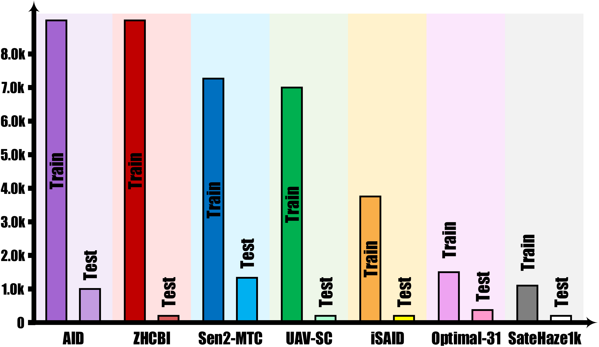

# RS-Agent
# 🚀 RS-Agent

> RS-Agent代码仓库/RSIR-Bench数据集

[](LICENSE)
[](https://www.python.org/)
[](https://pytorch.org/)

---

## 📢 News

- **[2026-11-20]** 项目主页初始化完成，敬请期待 🎉
- **[2026-11-21]** RSIR-Bench数据集发布
- **[待更新]** 对比方法训练权重发布
- **[待更新]** 本方法代码及权重发布

---

## 📋 TODO List

- [x] **数据集上传**（网盘链接已更新）
- [ ] **对比方法训练权重上传**（SOTA方法 checkpoint）
- [ ] **本方法代码及权重上传**（训练、推理代码 + 预训练模型）

> 进度会实时更新，欢迎 Watch / Star 关注 ⭐

---

## 🏗️ 网络架构 (Architecture)

<p align="center">
  
</p>

---

## 📊 数据集 (Dataset)

<p align="center">
  
</p>


### 下载地址

| 平台 | 链接 | 提取码 |
| --- | --- | --- |
| 百度网盘 | https://pan.baidu.com/s/xxxxxxxx | `xxxx` |

> ⚠️ 数据集仅供学术研究使用，请勿用于商业用途。

### 数据目录结构

```text
dataset/
├── blur/
│   ├── train/
│   │   ├── input/                 # 退化图像
│   │   └── gt/                    # 真值图像（与 input 同名）
│   └── test/
│       ├── input/
│       └── gt/
├── cloud/
│   ├── train/{input,gt}/
│   └── test/{input,gt}/
├── color/
│   ├── train/{input,gt}/
│   └── test/{input,gt}/
├── haze/
│   └── ...（同上三划分）
├── low_light/
│   └── ...
├── noise/
│   └── ...
└── shadow/
    └── ...
```

---

## 📝 引用

```bibtex
@article{yourname2025,
  title={XXX},
  author={XXX},
  year={2025}
}
```

## 📧 联系方式

如有问题，欢迎提交 Issue 或联系：`chikaichen@mail.nwpu.edu.cn`
